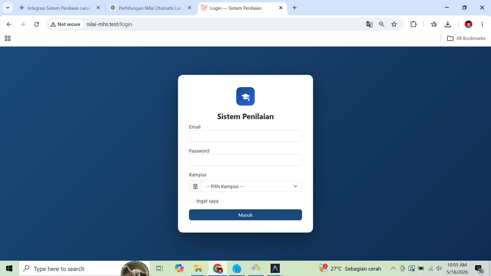
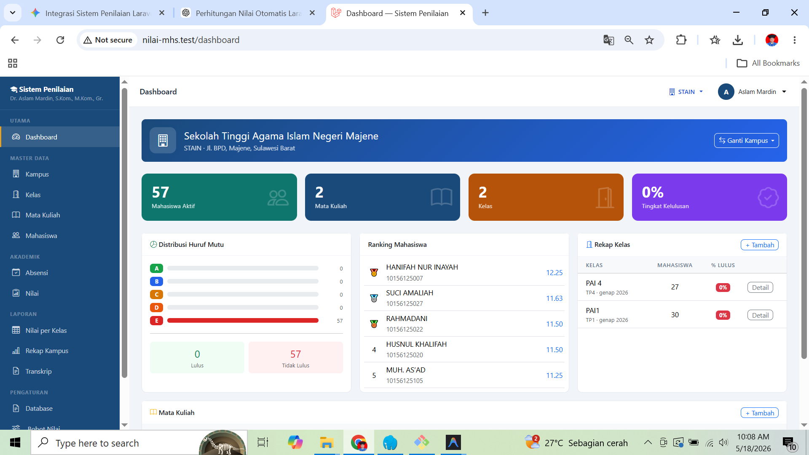
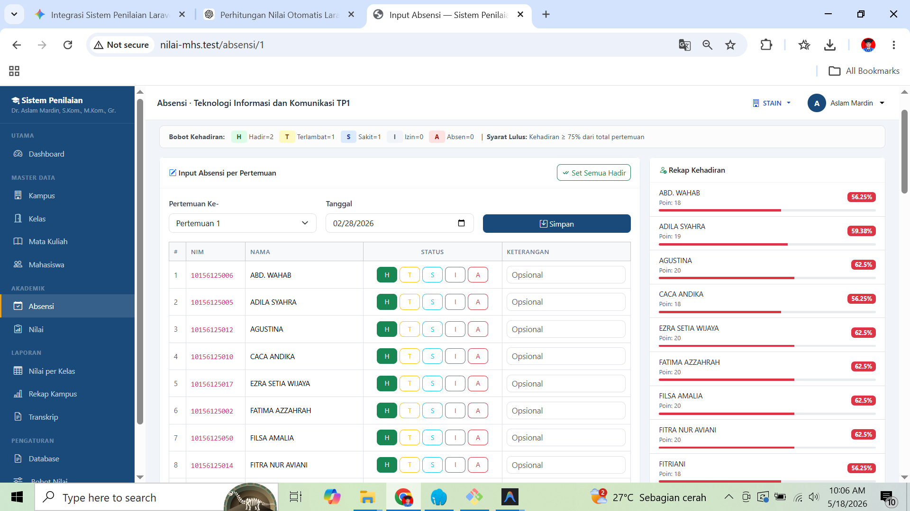
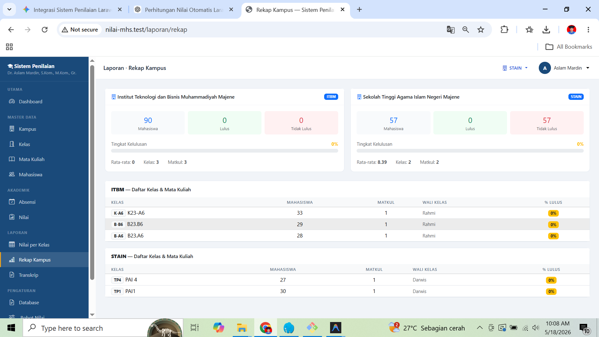

# 🎓 Nilai-Mhs: Sistem Penilaian & Akademik Terpadu

Aplikasi berbasis **Laravel** untuk mengelola data akademik secara komprehensif, mulai dari data mahasiswa, absensi harian, hingga kalkulasi otomatis nilai akhir dan pencetakan laporan.

---

## 🚀 Sekilas Aplikasi
**Nilai-Mhs** dirancang untuk memudahkan dosen dan pengelola kampus dalam:
- Mengelola data master (Kampus, Kelas, Mata Kuliah, Mahasiswa).
- Menginput absensi harian secara efisien dengan riwayat dan persentase kehadiran per pertemuan.
- Menghitung nilai mahasiswa menggunakan **standar bobot 100% murni**: **Kehadiran 25%**, **Tugas 20%**, **UTS 25%**, dan **UAS 30%**.
- Menerapkan **Keaktifan Mahasiswa sebagai BONUS Nilai (maksimal 10%)** yang langsung ditambahkan menghasilkan **Nilai Finish**.
- Menetapkan **Nilai Akhir (NA)** dan **Huruf Mutu** langsung dari **Nilai Finish** secara transparan tanpa nilai tersembunyi.
- Memvalidasi syarat kelulusan otomatis (Kehadiran $\ge 60\%$ dan NA $\ge 55$).
- Sinkronisasi otomatis antara absensi dan nilai akhir mahasiswa via `PenilaianService`.
- Mengekspor data rekapitulasi nilai dalam format PDF dan Excel (XLSX).

---

## 📊 Logika & Aturan Sistem Penilaian (Standar Terbaru)

Sistem menggunakan logika penilaian terpusat yang konsisten di seluruh modul (`PenilaianService`):

### 1. Bobot Penilaian Komponen 100% (NA Murni)
| Komponen | Bobot | Keterangan |
| :--- | :---: | :--- |
| **Kehadiran** | **25%** | Persentase kehadiran riil dari total pertemuan |
| **Tugas** | **20%** | Rata-rata nilai tugas terstruktur & mandiri (nilai murni yang tampil di tabel) |
| **UTS** | **25%** | Nilai Ujian Tengah Semester |
| **UAS** | **30%** | Nilai Ujian Akhir Semester |
| **Total Bobot** | **100%** | Komponen baku nilai akademik |

$$\text{NA Murni} = (\text{Hadir} \times 0.25) + (\text{Tugas} \times 0.20) + (\text{UTS} \times 0.25) + (\text{UAS} \times 0.30)$$

> **Catatan:** Nilai Tugas yang ditampilkan pada tabel adalah nilai murni dari database yang sama persis dengan yang dimasukkan ke dalam rumus NA Murni (tanpa angka kurung, tanpa nilai tersembunyi, dan tanpa nilai praktikum).

### 2. Keaktifan sebagai BONUS (Maksimal 10%)
Keaktifan bukan merupakan komponen pembagi bobot 100%, melainkan murni berfungsi sebagai **reward / BONUS tambahan nilai**:

$$\text{Bonus Keaktifan} = \text{Keaktifan} \times 10\%$$

*Contoh:*
- Skor Keaktifan $58{,}13 \rightarrow \text{Bonus} = +5{,}81$
- Skor Keaktifan $64{,}06 \rightarrow \text{Bonus} = +6{,}41$

### 3. Perhitungan Nilai Finish
Bonus Keaktifan langsung diterapkan ke dalam **Nilai Finish** dengan batas maksimal 100:

$$\text{Nilai Finish} = \min(100{,}00, \, \text{NA Murni} + \text{Bonus Keaktifan})$$

### 4. Nilai Akhir (NA) & Konversi Huruf Mutu
Nilai Akhir (NA) menggunakan **Nilai Finish** secara langsung tanpa aturan nilai alternatif/tersembunyi:

$$\text{Nilai Akhir (NA)} = \text{Nilai Finish}$$

Konversi Huruf Mutu ditentukan dari Nilai Akhir (NA):
* **$\ge 85.00$** $\rightarrow$ **A**
* **$75.00 - 84.99$** $\rightarrow$ **B**
* **$65.00 - 74.99$** $\rightarrow$ **C**
* **$55.00 - 64.99$** $\rightarrow$ **D**
* **$< 55.00$** $\rightarrow$ **E**

### 5. Syarat & Alasan Ketidaklulusan
Mahasiswa dinyatakan **LULUS** hanya jika memenuhi kedua kriteria berikut:
$$\text{Kehadiran} \ge 60\% \quad \text{DAN} \quad \text{Nilai Akhir} \ge 55$$

Jika salah satu atau kedua syarat tidak terpenuhi, sistem secara otomatis mencatat status **Tidak Lulus** beserta keterangannya:
* **Kehadiran $< 60\%$**: `"Kehadiran 59% (minimal 60%)"`
* **Nilai Akhir $< 55$**: `"Nilai akhir 50 (minimal 55)"`
* **Keduanya tidak terpenuhi**: `"Kehadiran 59% (minimal 60%); Nilai akhir 50 (minimal 55)"`
* **Lulus**: `null` (status Lulus)

### 6. Struktur Kolom Rekap Nilai
Tabel rekap nilai menampilkan alur penilaian yang jelas dan transparan:
$$\text{Hadir (25\%)} \mid \text{Keaktifan (Bonus 10\%)} \mid \text{Tugas (20\%)} \mid \text{UTS (25\%)} \mid \text{UAS (30\%)} \mid \mathbf{\text{NA Murni (100\%)}} \mid \mathbf{\text{Bonus}} \mid \mathbf{\text{Nilai Finish}} \mid \mathbf{\text{NA}} \mid \text{Mutu} \mid \text{Status}$$

---

## 📸 Tampilan Aplikasi (Screenshots)

Berikut adalah beberapa pratinjau antarmuka aplikasi:

### 1. Halaman Login

*Halaman autentikasi sistem.*

### 2. Dashboard Utama

*Gambaran statistik kampus, jumlah mahasiswa, dan tingkat kelulusan.*

### 3. Manajemen Master Data

*Halaman manajemen kelas perkuliahan.*


*Halaman manajemen daftar mahasiswa per kampus.*

### 4. Form Input Absensi Harian

*Tampilan form absensi per pertemuan.*

### 5. Modul Penilaian

*Form Keaktifan dengan sistem Checklist interaktif.*


*Penambahan dan pengisian kolom tugas secara dinamis.*


*Form untuk menginput nilai ujian (UTS/UAS).*

### 6. Rekapitulasi & Laporan

*Tabel rekapitulasi nilai akhir mahasiswa dan kehadiran.*


*Statistik nilai dan distribusi huruf mutu suatu mata kuliah.*


*Halaman laporan rekap keseluruhan.*


*Hasil ekspor dokumen ke format PDF.*

### 7. Pengaturan Sistem

*Halaman untuk mengatur persentase bobot tiap komponen nilai.*


*Fitur backup dan pemulihan database sistem.*


*Monitoring penggunaan resource server.*

### 8. Pengaturan Akun

*Halaman pengaturan data profil pengguna.*


*Halaman pergantian kata sandi yang aman.*

---

## 🔄 Alur Kerja (Workflow) Sistem

1. **Pengaturan Master Data (Admin/Kaprodi):**
   - Menambahkan data **Kampus** dan **Kelas**.
   - Menambahkan data **Mata Kuliah** beserta detail bobot (Teori/Praktikum) dan jumlah pertemuannya.
   - Memasukkan data **Mahasiswa** ke dalam kelas.

2. **Manajemen Kelas (KRS/Pendaftaran):**
   - Mendaftarkan mahasiswa ke mata kuliah tertentu agar mereka masuk ke dalam daftar absensi dan penilaian.

3. **Operasional Harian (Dosen):**
   - **Absensi:** Dosen masuk ke menu Absensi, memilih pertemuan, dan mencatat status kehadiran mahasiswa. Keterangan spesifik (Sakit, Izin) dapat dicantumkan.
   - **Keaktifan:** Dosen masuk ke form Keaktifan, lalu mengklik sel mahasiswa untuk mencentang indikator keaktifan. Sistem mencegah skor melebihi batas maksimal (100).
   - **Tugas:** Dosen bebas menambahkan kolom-kolom tugas spesifik dan mengisi skornya. Sistem otomatis membagi rata-ratanya.

4. **Ujian & Penilaian Akhir (Akhir Semester):**
   - Dosen menginput nilai UTS dan UAS di form **Input Teori** (atau mengedit kolom nilai jika diperlukan).
   - Sistem secara otomatis menghitung **NA Murni (100%)**: Kehadiran (25%) + Tugas (20%) + UTS (25%) + UAS (30%).
   - Sistem menghitung **Bonus Keaktifan**: $\text{Keaktifan} \times 10\%$.
   - Sistem menghasilkan **Nilai Finish**: $\min(100{,}00, \, \text{NA Murni} + \text{Bonus Keaktifan})$.
   - **Nilai Akhir (NA)** dan **Huruf Mutu** (A, B, C, D, E) ditetapkan langsung dari Nilai Finish.
   - Sistem memvalidasi syarat kelulusan (Kehadiran $\ge 60\%$ DAN Nilai Akhir $\ge 55$). Mahasiswa dengan kehadiran $< 60\%$ otomatis berstatus **Tidak Lulus** tanpa penghapusan nilai asli.
   - Tombol **Kalkulasi Ulang** tersedia di halaman rekap nilai untuk menyinkronkan seluruh nilai mahasiswa kapan saja.

5. **Pelaporan (Laporan & Cetak):**
   - Nilai akhir terkonversi secara otomatis ke Huruf Mutu (A, B, C, D, E).
   - Pengelola mencetak Laporan Rekap Nilai Mata Kuliah atau mendistribusikan berkas dalam wujud Excel (XLSX) maupun PDF.

---

## ⚙️ Syarat Sistem & Instalasi

### Prasyarat
- PHP >= 8.2
- Composer
- MySQL / MariaDB
- Node.js & NPM (Opsional, untuk aset Vite)

### Langkah-langkah Instalasi

1. **Kloning Repositori**
   ```bash
   git clone https://github.com/username/nilai-mhs.git
   cd nilai-mhs
   ```

2. **Instalasi Dependensi**
   ```bash
   composer install
   npm install && npm run build
   ```

3. **Konfigurasi Lingkungan (Environment)**
   Salin file konfigurasi bawaan dan sesuaikan kredensial database Anda:
   ```bash
   cp .env.example .env
   php artisan key:generate
   ```
   *Buka file `.env` lalu sesuaikan `DB_DATABASE`, `DB_USERNAME`, dan `DB_PASSWORD` Anda.*

4. **Migrasi Database & Seeding**
   Siapkan struktur tabel dan data *dummy* awal dengan menjalankan perintah berikut:
   ```bash
   php artisan migrate:fresh --seed
   ```

5. **Jalankan Aplikasi**
   ```bash
   php artisan serve
   ```
   Aplikasi dapat diakses di: `http://localhost:8000`

### Akun Login Default
- **Email:** `aslam11mardin@gmail.com`
- **Password:** `password`

*(Catatan: Sesuaikan kembali email ini jika Anda memodifikasi file DatabaseSeeder)*

---

## 🛠 Teknologi yang Digunakan
- **Backend:** Laravel 11+, PHP 8.2+
- **Frontend:** Blade Templating, Bootstrap 5, Vanilla JavaScript
- **Database:** MySQL
- **Library Ekspor:**
  - `barryvdh/laravel-dompdf` (PDF)
  - `maatwebsite/excel` (Excel)
